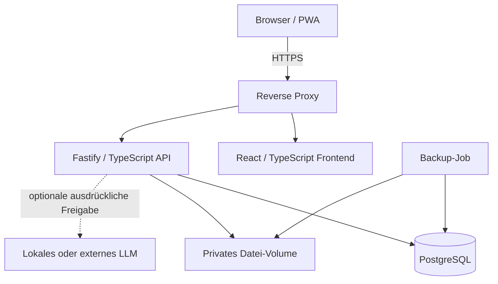

# Technische Architektur (Entwurf)

Status: **Architecture Proposal – noch nicht implementiert**. Grundlage ist eine selbst hostbare, wartbare Web-App mit geringer Zahl an laufenden Diensten.

## Systemübersicht

## Komponenten

- **Web:** React + Vite + TypeScript. Client-Routing, Formulare, responsive Komponenten; keine Secrets im Browser-Bundle.
- **API:** Fastify + TypeScript; JSON-Schemas mit Zod und konsequenter serverseitiger Validierung. Öffentliche API-Routen sind versioniert (`/api/v1`).
- **Domain:** gemeinsame, testbare Kernlogik für Credits, Abschlussstatus, Wahlregeln, Zulassung und Wiederholungspläne. Keine Regeln ausschließlich im Frontend.
- **Persistenz:** PostgreSQL über Drizzle ORM und versionierte Migrationen. Keine direkte Datenbankverbindung aus dem Browser.
- **Dateien:** Uploads in eigenem privaten Volume; nur Metadaten/Dateireferenzen in der DB. Uploads optional für den MVP.
- **Infrastruktur:** Docker Compose auf einer Linux-VM oder einem anderen Docker-fähigen Host; vorgeschalteter Reverse Proxy mit TLS. Keine feste Domain oder feste Hardware voraussetzen.

## Sicherheit

- Anmeldungen mit robustem Passwort-Hashing (z. B. Argon2id), serverseitigen Sessions und sicheren `HttpOnly`-Cookies.
- `Secure`/`SameSite`-Cookies über HTTPS; CSRF-Schutz für zustandsändernde Requests und Rate Limits für Auth-Endpunkte.
- Jede Datenabfrage wird auf die autorisierte Nutzeridentität eingeschränkt. Objektberechtigungen werden im Backend getestet.
- Geheimnisse nur via Umgebungsvariablen/Secret-Store zur Laufzeit; `.env.example` darf ausschließlich Platzhalter enthalten.
- API-Logging ohne sensible Inhalte, Passwörter, Uploadtexte oder Tokens; sichere Fehlerantworten.
- Kein offener PostgreSQL-Port zum Internet; Container-Netze und minimale Rechte.
- Abhängigkeits-/Image-Scans sowie Tests vor Releases.

## Datensicherung und Wiederherstellung

- Regelmäßige PostgreSQL-Sicherungen und, sofern verwendet, Upload-Volume-Sicherungen.
- Verschlüsselte, zugriffsbeschränkte Ablage **außerhalb des Git-Repositories**.
- Wiederherstellung auf separater Testinstanz prüfen.
- DB-Migrationen, Versionen und Backup-Kompatibilität dokumentieren; Rollback-Strategie definieren.

## Optionaler KI-Pfad

KI ist eine austauschbare, deaktivierte Erweiterung und darf den MVP nicht blockieren. Ein Adapter kann später lokal gehostete oder externe Anbieter ansprechen. Jeder Datentransfer wird dem Nutzer angezeigt und erfordert eine explizite Freigabe; API-Schlüssel bleiben serverseitig. Ergebnisse werden als generiert gekennzeichnet und sind nicht automatisch prüfungsrechtlich verbindlich.

## Entwicklungs- und Qualitätsprozess

- Änderungen über Pull Requests mit Review, automatischen Unit-, Integrations- und E2E-Tests.
- Lokale Testdaten werden mit einem **synthetischen** Seed erzeugt.
- Builds sollen reproduzierbar sein (Lockfiles, gepinnte Container-Versionen, CI).
- Entwicklungs- und Produktionsumgebung klar trennen.
- Ressourcenbedarf erst mit einem lauffähigen Prototyp unter dokumentierter Last messen; keine unbelegten Hardware-Mindestwerte veröffentlichen.

## Designentscheidungen (offen)

- Konkrete Auth-/Session-Bibliothek
- Single-User-Modus im MVP gegenüber voll mandantenfähiger Datenhaltung
- Storage/Import-Formate und Upload-Limits
- Exakte Versionen und Lizenzprüfung der Abhängigkeiten
- Freigabe der Lizenz für das Repository
